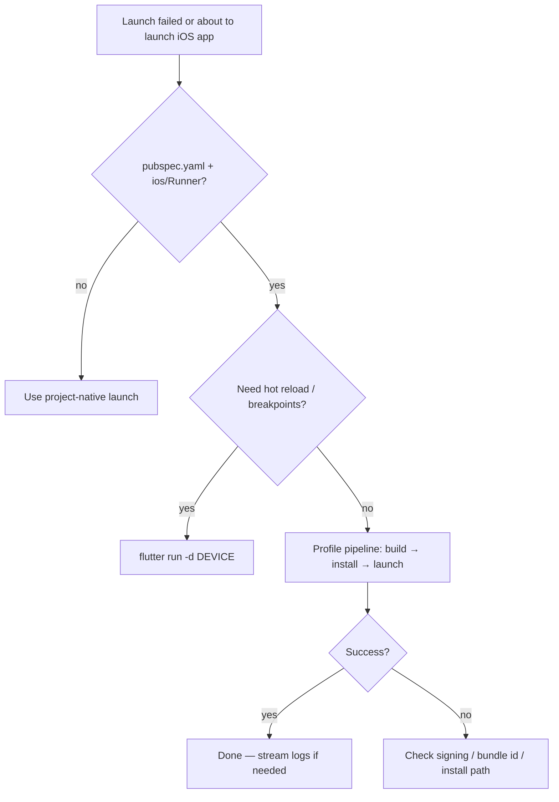

# Delete Fix Blueprint — Flutter iOS Standalone Launch (Profile, not Debug)

**Blueprint ID:** `flutter-ios-devicectl-sig11-v1`  
**Applies to:** Flutter apps on iOS 14+ launched via `devicectl`, home screen, or any path **without** `flutter run` / Xcode Flutter debugger attached  
**Isle project root:** `isle/` (Flutter package directory)

---

## 1. Problem class (auto-detect)

Treat launch as **this failure class** when **any** of the following appear in stdout/stderr within ~3s of launch:

| Signal | Example text |
|--------|----------------|
| A | `Cannot create a FlutterEngine instance in debug mode without Flutter tooling or Xcode` |
| B | `App terminated due to signal 11` (SIGSEGV) immediately after devicectl launch |
| C | Command was `devicectl device process launch` **and** app is Flutter (`pubspec.yaml` exists, `ios/Runner`) **and** build was **Debug** (no prior `flutter run` session) |
| D | Exit code `1` from devicectl launch with bundle id matching Debug dev bundle (Isle: `com.isle.app.isle.dev`) after Debug-only install |

**Root cause (do not “fix” in Dart):** Debug Flutter embeds a VM that expects the tool chain. Standalone launch is unsupported on iOS 14+.

**Not this class:** App runs then crashes later, OOM, signing errors, “unable to install”, missing provisioning.

---

## 2. Automatic resolution policy (always follow)



### Rule 1 — Never use Debug + devicectl for Flutter

**Forbidden default for Flutter:**

```bash
# DO NOT use as the only launch path for Flutter on device
xcrun devicectl device process launch --console --device "$DEVICE" "$DEBUG_BUNDLE_ID"
```

after a Debug-only build.

### Rule 2 — Use Profile (or Release) for standalone device launch

**Required pipeline for Delete Fix “run on phone and capture console”:**

1. `cd "<FLUTTER_ROOT>"` (Isle: repo `isle/`)
2. `flutter pub get`
3. `flutter build ios --profile` (or `--release` for store-like builds)
4. Install: `xcrun devicectl device install app --device "$DEVICE" build/ios/iphoneos/Runner.app`
5. Launch: `xcrun devicectl device process launch --console --device "$DEVICE" "$BUNDLE_ID"`

### Rule 3 — Prefer project wrapper script (idempotent)

If present, **always call this first** (Isle):

```bash
cd "<REPO>/isle"
./tool/deletefix_launch.sh "$DEVICE_UDID"
```

Script handles build mode, install, launch, and re-tries. Do not duplicate logic in Delete Fix unless script is missing.

### Rule 4 — Hot reload / debugging session

When user needs breakpoints or hot reload:

```bash
cd "<REPO>/isle"
flutter run -d "$DEVICE_UDID"
# or: flutter run --profile -d "$DEVICE_UDID"
```

Do **not** chain devicectl launch after this; Flutter owns the process.

### Rule 5 — Xcode configuration alignment (one-time / on mismatch)

For Flutter iOS, **Profile** build configuration must use the **same bundle id** Delete Fix launches.

| Isle config | Bundle ID | Display name |
|-------------|-----------|----------------|
| Debug | `com.isle.app.isle.dev` | Isle Dev |
| **Profile** | `com.isle.app.isle.dev` | Isle Dev |
| Release | `com.isle.app.isle` | Isle |

Xcode scheme for standalone: `Runner-Profile-Dev` → build configuration **Profile**.

If Profile bundle ≠ Debug dev bundle, update `ios/Runner.xcodeproj/project.pbxproj` Profile `PRODUCT_BUNDLE_IDENTIFIER` to match Debug dev id, then re-run Rule 2.

---

## 3. Isle-specific constants

```yaml
flutter_root: isle/
wrapper_script: isle/tool/deletefix_launch.sh
profile_script: isle/tool/ios_device_profile.sh
bundle_id_standalone: com.isle.app.isle.dev
bundle_id_release: com.isle.app.isle
app_artifact: isle/build/ios/iphoneos/Runner.app
xcode_scheme_standalone: Runner-Profile-Dev
min_ios: 16.0
```

---

## 4. Delete Fix workflow (copy into automation)

### Phase A — Preflight

1. Resolve `DEVICE` from connected hardware (prefer USB; use `flutter devices` or `xcrun devicectl list devices`).
2. Confirm `isle/pubspec.yaml` exists → **Flutter project**.
3. Set `LAUNCH_MODE=standalone` unless user explicitly asked for “debug attach” / “hot reload”.

### Phase B — Build & install (standalone)

```bash
export FLUTTER_ROOT="<absolute>/isle"
cd "$FLUTTER_ROOT"
./tool/deletefix_launch.sh "$DEVICE"
```

### Phase C — Verify success

Success criteria (all within 30s):

- [ ] `devicectl install` exit 0
- [ ] `devicectl process launch` does **not** print FlutterEngine debug-mode error
- [ ] Process stays alive > 5s (no immediate signal 11)
- [ ] Optional: app shows UI on device

### Phase D — On failure

| Symptom | Action |
|---------|--------|
| Still signal 11 + debug engine message | Confirm installed `.app` is Profile: `flutter build ios --profile` was run; delete app from device; reinstall |
| Wrong bundle | Launch `com.isle.app.isle.dev` not release id unless Release build |
| Signing | Open `ios/Runner.xcworkspace` in Xcode; fix team `V3J8MR637G` / automatic signing |
| User wants debugger | Switch to `flutter run -d "$DEVICE"`; stop using devicectl launch |

### Phase E — Log capture

After successful launch, keep `--console` attached until user cancels or app exits. On crash **after** warm start, treat as app bug — collect `isle` debug logs (`Isle Debug` folder / in-app Debugger).

---

## 5. Generic Flutter detector (any repo)

Run before choosing launch strategy:

```bash
if [[ -f pubspec.yaml ]] && [[ -d ios/Runner ]]; then
  echo "FLUTTER_IOS=true"
fi
```

If `FLUTTER_IOS=true` and launch method is `devicectl` without `flutter run`:

→ force **Profile or Release** build pipeline (Section 2, Rule 2).

---

## 6. Machine-readable policy (optional parser)

See `isle/blueprints/deletefix_flutter_ios_policy.json` in this repo.

---

## 7. What Delete Fix must NOT do

- Do not patch Dart/`main.dart` to “fix” signal 11 on immediate launch when debug engine message is present.
- Do not retry the same Debug devicectl launch more than once without switching to Profile.
- Do not assume SIGSEGV = memory bug in app code on first frame.
- Do not change Release bundle id to `.dev` for App Store builds.

---

## 8. Version stamp

When reporting fixes, include app version from `isle/lib/core/constants/app_release_info.dart` (`AppReleaseInfo.label`).

---

*End of blueprint — attach this file to Delete Fix project instructions or paste Sections 2 + 4 + Isle constants.*
